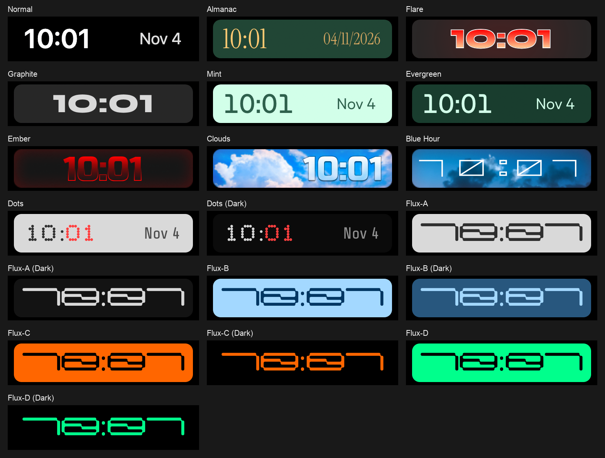

# Clocky

Clocky turns the Stream Deck Neo Infobar into a four-screen display. By default, **Next Screen** cycles through **Clock → Media Player → AI Tokens → System Stats → Clock**. **Previous Screen** moves through the enabled screens in reverse. During a swipe, the wallpaper and content shrink together to 82% around the center of the outgoing page. The incoming page enters at 82% and grows to full size as it settles.

[Preview the slide transitions with sample media and usage data](screens.gif).

## Set up in OpenDeck

1. Download [Clocky.streamDeckPlugin from the latest release](https://github.com/Ralsei-x64/Clocky/releases/latest/download/Clocky.streamDeckPlugin). In OpenDeck 2.13 or newer with Node.js 22 or newer, open the plugin manager, choose **Install from file**, and select the download.
2. If Clocky is already on the Infobar, keep that assignment. For a new setup, drag **Clocky → Clockface** onto the Infobar between the Neo’s touch points.
3. Drag **Clocky → Previous Screen** and **Clocky → Next Screen** onto any two keys or the two touch points beside the Infobar. Either action also works on its own. Select each assignment and choose its color. This sets the side light on a touch point or the arrow stroke on an LCD key. If an assignment from an older version opens without a color picker, drag the same action back onto its slot.
4. Select the Infobar and open **Pages**. Choose **Default page** to set which page opens first and which page the timer returns to. Use **Return to default page after (seconds)** to set the delay. The timer starts when navigation settles and returns with a single swipe. The initial delay is 30 seconds. Set it to 0 to turn off automatic return.
5. Use **↑** and **↓** to reorder pages and the checkboxes to turn them on or off. **First enabled page** follows this order. A named default stays selected across reordering. If you disable it, Clocky temporarily uses the first enabled page. Turning off all pages leaves the Infobar blank.

Hold **Previous Screen** or **Next Screen** for three seconds to pin the page you’re viewing. A lock confirmation slides up, stays visible for two seconds, and slides down to reveal the pinned page. Both navigation buttons stay dim white while the page is pinned. Tap either button to switch pages, restore the assigned button colors, and resume the automatic return timer.

## Screens

**Clock** shows local time in 24-hour format and updates on the minute. Normal is the default face. Normal, Mint, Evergreen, and Dots show the month and day. Almanac adds the numeric date. Dots uses a dot matrix with red minutes. Dots and all four wide-numeral Flux faces each have light and dark versions. [Open the live clockface preview](dev.clocky.neo.sdPlugin/inspector.html).



To customize any face, select it in the Infobar settings and choose **Background image or GIF**. Under **Use background on**, choose **This clockface** or **All faces without their own image**. Images are center-cropped to the 232 × 50 face. Animated GIFs use their frame delays and loop count in both the preview and the Infobar. Clocky stores the resized backgrounds in the OpenDeck profile. **Clear face background** restores the shared background if present, or the original design.

With a wallpaper selected, choose a tint color and drag **Strength** to preview it behind the time. Each face saves its own tint, including when it uses a shared wallpaper. Set the slider to **0%** to turn the tint off.

**Media Player** shows the title, artist, artwork, elapsed time, and duration when the player supplies them. A long title or artist name pauses at the beginning, scrolls across its own line, and loops. Short lines stay still. A missing timestamp appears as `--:--`.

For Zen and other compatible browsers on macOS, install the system Now Playing reader with `brew install media-control`. While Media Player is enabled, Clocky listens for track and artwork updates, prepares the cover in the background, and caches recent covers. Titles can appear while their covers load. If the system reader is unavailable, Clocky checks Kaset, Music, and Spotify. macOS may ask for Automation access to those players. Linux uses `playerctl` and MPRIS. Windows uses the system media session. With no reported track, the display shows “Nothing is playing...”. [macOS Now Playing reader](https://formulae.brew.sh/formula/media-control)

Enable **Show Now Playing for 2 seconds when a song starts or changes** in the Infobar’s **Pages** settings to briefly see the track when playback starts, resumes, or switches songs. The display slides back to the previous page after two seconds, then restarts its usual return timer. A pinned page stays in place, and using either navigation button takes control of the display.

**AI Tokens** shows the percentage remaining for the selected Codex metric.

| Setting | Reading |
| --- | --- |
| Current usage window | The current primary allowance reported by the signed-in Codex CLI |
| Weekly allowance | The seven-day allowance, including plans that report it as their primary window |
| Conversation context | Usable context remaining in the most recently active local Codex conversation, calculated from its latest token-usage record |

Account usage refreshes once per minute while visible. On weekly-only plans, the first two options show the same allowance. If the CLI is unavailable, Clocky can use an unexpired account reading from a local session recorded within the last 15 minutes. Context usage refreshes every ten seconds from the local Codex sessions directory. An em dash indicates an unavailable reading. [Codex context calculation](https://github.com/openai/codex/blob/main/codex-rs/tui/src/token_usage.rs)

**System Stats** shows CPU, GPU, and RAM usage alongside the battery charge. Each gauge reads from 0 to 100. CPU, GPU, and RAM turn red at 80%. The battery ring turns red at 20% or below. Above 20%, it is white on battery power and green when plugged in. A lightning bolt appears while the battery is charging. Clocky refreshes the readings about every two seconds while the page is visible. An em dash means the computer or graphics driver did not report a reading.

## Development

Clocky 1.7 sends changed artwork, media rows, and timeline data to the native renderer in OpenDeck Sonic. Sonic animates the 360 ms swipe from cached page images and encodes each changed frame once. While Media Player is open, the Neo receives just the rectangle containing the pixels that changed. Standard OpenDeck uses self-contained 248 × 58 SVG frames. Both paths center the 232 × 50 layouts inside the display. Keys send navigation events for their device and profile. In OpenDeck Sonic settings, **Animation frame rate** selects 30 or 60 fps for Clocky animations. **Reduce tearing** independently paces complete device frames at the selected rate. Clocky uses 30 fps on standard OpenDeck. [OpenAction keypad events](https://openaction.amankhanna.me/api/clientbound/keypad.html) · [Neo display dimensions](https://docs.elgato.com/streamdeck/hid/stream-deck-neo/)

Run `node --test tests/clocky.test.cjs` to test the plugin. To build a fresh package, zip the entire `dev.clocky.neo.sdPlugin/` directory at the root of a new archive and give it the `.streamDeckPlugin` extension. Preserve the executable permission on `clocky-mac` and `sources/mac-stats`.

The macOS sensor helper is included for Apple silicon and Intel. To rebuild it on macOS, run the following from the project root.

```sh
clang -O2 -arch arm64 -arch x86_64 -mmacosx-version-min=11.0 tools/mac-stats.c -framework CoreFoundation -framework IOKit -o dev.clocky.neo.sdPlugin/sources/mac-stats
codesign -s - -f dev.clocky.neo.sdPlugin/sources/mac-stats
```

The font outlines can be regenerated with Python 3.10+ and the HarfBuzz CLI. Run `python3 tools/make-glyphs.py FONT_DIRECTORY` with the original Instrument Serif, Syne, SUSE, Russo One, Share Tech, and FluxVF files in that directory. Font licenses ship with the plugin. [Google Fonts source files](https://github.com/google/fonts/tree/main/ofl) · [Flux source files](https://github.com/ralphbruens/flux)
